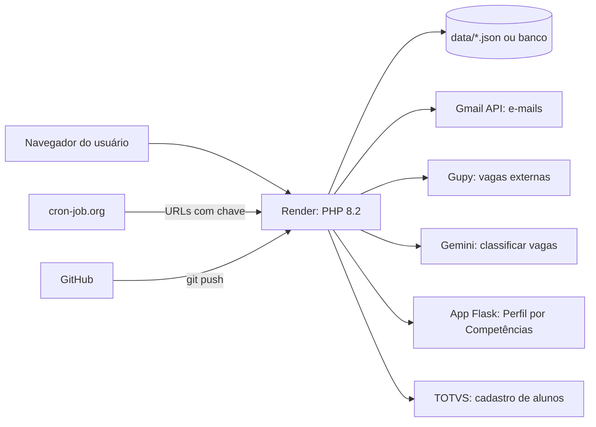
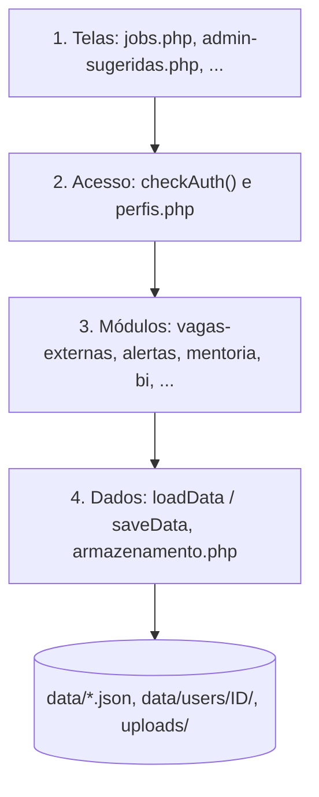
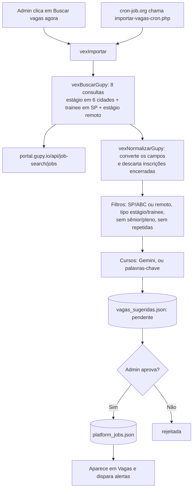
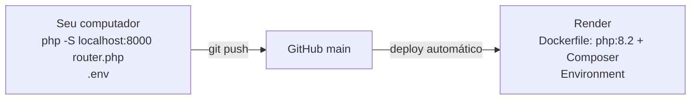

# Arquitetura da Central de Estágios FSA

> Versão 7 (outubro de 2026). Este documento explica **como o sistema é montado**.
> Para saber **como mexer** em cada parte, veja o `docs/GUIA-PASSO-A-PASSO.md`.

---

## 1. Visão geral

A Central de Estágios é um site em **PHP 8.2 puro**, sem framework e sem banco obrigatório. Todos os dados ficam em arquivos JSON na pasta `data/`. Se for preciso, dá para trocar por um banco de dados sem mexer nas telas.

| Item | Tecnologia |
| --- | --- |
| Linguagem | PHP 8.2 |
| Bibliotecas (Composer) | `vlucas/phpdotenv` (lê o `.env`) e `phpmailer/phpmailer` |
| Visual | Tailwind CSS e Font Awesome (por CDN), Chart.js nos Painéis BI |
| Dados | Arquivos JSON em `data/` (padrão) ou banco MySQL, PostgreSQL ou SQLite (`DADOS_DRIVER=banco`) |
| Hospedagem | Render (plano gratuito), com `Dockerfile` e deploy automático a cada `git push` |
| Código-fonte | GitHub (repositório privado), branch `main` |

---

## 2. As quatro camadas

Cada camada só conversa com a de baixo. Quem chama os serviços de fora são só os módulos (camada 3). As telas nunca chamam uma API direto.

| Camada | O que tem | Onde fica |
| --- | --- | --- |
| 1. Telas | As páginas e o menu | `*.php` da raiz, `includes/header.php`, `includes/footer.php` |
| 2. Acesso | Quem é o usuário e o que ele pode ver | `includes/config.php` (`checkAuth`) e `includes/perfis.php` |
| 3. Módulos | As regras de cada assunto | os outros arquivos de `includes/` |
| 4. Dados | Leitura e gravação | `loadData` e `saveData` (no `config.php`), que chamam o `includes/armazenamento.php` |

### O que acontece quando uma página abre

1. A página faz `require_once 'includes/config.php'`.
2. O `config.php` inicia a sessão, ajusta o fuso para São Paulo, lê o `.env` (se ele existir) e carrega o `armazenamento.php` e o `perfis.php`.
3. A página chama `checkAuth()`. Quem não está logado volta para o `index.php`. Se a página não está na lista do perfil, o usuário volta para a página inicial dele.
4. A página carrega os módulos de que precisa, lê os dados com `loadData()` e monta o HTML.
5. O `header.php` desenha o menu do perfil e as bolinhas de aviso, e roda a `alertasTick()` (a fila de e-mails).

---

## 3. Perfis de acesso (`includes/perfis.php`)

Todo o controle de acesso está num lugar só, o `perfisRegistro()`. Cada perfil tem uma **lista fechada de páginas**: se a página não está na lista, ninguém abre.

| Grupo | Perfil | Como o `usuarios.json` define | Começa em |
| --- | --- | --- | --- |
| Alunos | `aluno` | sem `tipo` | `dashboard.php` |
| Alunos | `aluno_restrito` | `"tipo": "aluno_restrito"` | `dashboard.php` |
| Professores | `professor` | `"tipo": "professor"` | `dashboard.php` |
| Egressos | `egresso` | `"tipo": "egresso"` | `jobs.php` |
| Funcionários | `admin` (Coordenação de Estágios) | `"is_admin": true` | `dashboard.php` |
| Funcionários | `admin_egressos` (Coordenação de Egressos) | `"is_admin": true` e `"tipo": "admin_egressos"` | `dashboard.php` |

Cada perfil tem cinco partes:

| Parte | O que é |
| --- | --- |
| `home` | Página aberta depois do login |
| `fallback` | Para onde vai quem tenta abrir uma página proibida |
| `paginas` | Lista fechada das páginas que o perfil pode abrir |
| `menu` | Ícones do menu lateral (feitos com `perfilItemMenu()`) |
| `recursos` | Permissões dentro das telas, testadas com `perfilPode('nome')` |

| Recurso | Quem tem | O que libera |
| --- | --- | --- |
| `area_aluno` | aluno, aluno restrito | Cartões de currículo e certificados no Início |
| `candidatar` | aluno, aluno restrito | O botão Candidatar-se registra em Minhas Vagas |
| `favoritar` | aluno, aluno restrito | Botão Salvar vaga |
| `alertas` | aluno | Meus Alertas e resumo semanal |
| `ia_perfil` | aluno | Perfil por Competências |
| `vagas_egresso` | aluno, professor, egresso, funcionários | Vagas divulgadas por egressos |
| `divulgar_vaga`, `ser_mentor` | egresso | Telas do egresso |
| `gestao` | funcionários | Telas de gestão |

As marcas antigas da sessão (`is_admin`, `is_egresso`, `is_admin_egressos`, `is_restrito`) continuam funcionando, porque a `perfilSincronizarSessao()` mantém essas marcas iguais ao perfil. Telas novas devem usar `perfilPode()`.

---

## 4. Módulos (`includes/`)

| Arquivo | Responsável por |
| --- | --- |
| `config.php` | Sessão, `.env`, `checkAuth()`, `loadData()`, `saveData()` e a lista de cursos (`getFsaCourses()`) |
| `perfis.php` | Perfis, páginas, menu e recursos |
| `armazenamento.php` | Onde os dados ficam: JSON ou banco (`DADOS_DRIVER`) |
| `header.php`, `footer.php` | Topo, menu lateral, bloqueio por má conduta, bolinhas de aviso |
| `vagas.php` | Validade das vagas (encerramento automático) e vagas salvas |
| `vagas-externas.php` | Busca na Gupy (ou no Adzuna), filtro de cidade e de tipo, cursos por palavras-chave ou pelo Gemini, fila de Vagas Sugeridas |
| `melhorias.php` | Funções da fase 5: filtros de cidade, modalidade e bolsa, selos das vagas, `mhSemAcento()`, `mhChaveVaga()`, registro de ações do admin |
| `matching.php` | Pontuação aluno x vaga ("Vagas para Você") |
| `alertas.php`, `alertas-card.php` | Alertas por curso, fila de e-mails e resumo semanal |
| `avisos.php` | Bolinhas vermelhas do menu e e-mails de "chegou algo para você" |
| `notificacoes.php`, `email-config.php`, `GmailMailer.php` | Envio de e-mails pela Gmail API |
| `egressos.php` | Funções do módulo de egressos |
| `mentoria.php` | Mentores, pedidos e chat |
| `course.php` | Regras de estágio obrigatório e horas de cada curso (`data/course.json`) |
| `relatorios.php` | Relatórios de empregabilidade em Excel e PDF |
| `bi.php` | Fontes de dados, modelos e permissões dos Painéis (pastas e painéis compartilhados) |
| `perfil_api.php` | Ponte com o app Flask do Perfil por Competências |
| `acesso_log.php` | Registro dos logins |
| `proximas-acoes.php`, `curriculo-extras.php`, `perfil-extras.php`, `dicas-extras.php` | Partes extras do Início, do Currículo, do Perfil e das Dicas de Carreira |
| `integracoes/` | TOTVS e conexão com banco (veja a seção 7) |

---

## 5. Telas (raiz do projeto)

| Área | Telas |
| --- | --- |
| Entrada | `index.php` (login), `forgot-password.php` |
| Aluno | `dashboard.php`, `profile.php`, `curriculum.php` (+ `pdf-section.php`), `documents.php`, `jobs.php`, `minhas-vagas.php`, `vagas-para-voce.php`, `career-tips.php`, `signature.php`, `mentoria.php`, `request-job.php` |
| Ações do aluno (sem tela) | `candidatar.php`, `favoritar.php`, `alertas-salvar.php`, `perfil-extras-salvar.php`, `mentoria-chat.php` (JSON) |
| Egresso | `egresso-perfil.php`, `egresso-publicar.php`, `mentoria.php` |
| Coordenação | `admin-paineis.php` (Painéis, + `bi-dados.php`), `admin-dashboard.php` (Gestão de Alunos), `admin-jobs.php`, `admin-sugeridas.php`, `admin-signature.php`, `posts.php`, `admin-totvs.php`, `admin-alertas.php` |
| Coordenação de Egressos | Tudo da Coordenação, mais `admin-egressos.php` (Gestão de Egressos), `admin-mentoria.php`, `admin-relatorios.php` (aberto pela aba Relatórios dos Painéis) |
| Rotinas (chamadas pelo agendador) | `resumo-semanal.php`, `importar-vagas-cron.php` |
| Só redirecionam (links antigos) | `candidaturas.php`, `favoritos.php`, `egressos.php`, `admin-alunos-importar.php`, `admin-funil.php` |
| Ferramentas de terminal | `teste-gupy.php`, `ferramentas/migrar-dados.php` |

---

## 6. Dados

### 6.1 Arquivos gerais (`data/`)

| Arquivo | O que guarda |
| --- | --- |
| `usuarios.json` | Todos os usuários: CPF, senha (hash), perfil, curso e status |
| `platform_jobs.json` | Vagas publicadas (da FSA e externas aprovadas) |
| `vagas_sugeridas.json` | Fila das vagas externas: `pendente`, `aprovada` ou `rejeitada` |
| `job_requests.json` | Vagas sugeridas pelos alunos |
| `egresso_jobs.json` | Vagas divulgadas por egressos |
| `assinaturas.json` | Pedidos de assinatura de documentos |
| `mentoria_pedidos.json` | Pedidos de mentoria e chat |
| `platform_posts.json` | Posts do mural |
| `course.json` | Regras de estágio de cada curso |
| `fila_emails.json`, `alertas_estado.json` | Fila de e-mails e controle do resumo semanal |
| `admin_log.json`, `acessos_log.json` | Ações dos admins e logins |
| `bi/pastas.json`, `bi/paineis.json`, `bi/fontes.json` | Pastas, painéis e fontes criadas dos Painéis (o antigo `bi/painel_<id>.json` é levado para "Meus painéis particulares") |
| `totvs_exemplo.json` | Alunos de exemplo para testar o TOTVS no modo `teste` |

### 6.2 Dados de cada usuário (`data/users/<id>/`)

`userProfile.json`, `userCurriculum.json`, `userCertificates.json`, `userCandidaturas.json`, `userFavoritos.json` e `perfilResultado.json`.

### 6.3 Arquivos enviados (`uploads/`)

Fotos, PDFs e documentos assinados. **A pasta `uploads/` não vai para o Git.**

### 6.4 Como o JSON vira banco

Toda leitura e gravação passa por `loadData()`, `saveData()` e `dadosOperar()`, que chamam o `armazenamento.php`. Com o banco configurado (`DADOS_DB_DSN`):

- cada aba grava na **sua tabela** (`includes/banco-tabelas.php`: `central_usuarios`, `central_vagas`, `central_mentoria`...);
- toda gravação também vai para o JSON (espelho), que continua indo para o git;
- se o banco cair ou não for encontrado, a Central usa os JSON e anota o que mudou; quando o banco volta, sincroniza sozinha;
- na primeira conexão, o `data/` é copiado para o banco.

Tela **Banco de dados** (`admin-banco.php`). Tudo explicado em `docs/BANCO-DE-DADOS.md`.

---

## 7. Integrações

| Serviço | Arquivo | Variáveis | Obrigatório? |
| --- | --- | --- | --- |
| Gmail API (e-mails) | `includes/GmailMailer.php`, `email-config.php` | `GMAIL_CLIENT_ID`, `GMAIL_CLIENT_SECRET`, `GMAIL_REFRESH_TOKEN`, `GMAIL_SENDER_EMAIL` | Só para mandar e-mail |
| **Gupy** (vagas externas) | `includes/vagas-externas.php` | `VAGAS_FONTE=gupy` (é o padrão; não tem chave) | Não |
| Adzuna (vagas externas, pago) | `includes/vagas-externas.php` | `VAGAS_FONTE=adzuna`, `ADZUNA_APP_ID`, `ADZUNA_APP_KEY` | Não |
| Gemini (classificar vagas) | `includes/vagas-externas.php` | `GEMINI_API_KEY`, `GEMINI_MODEL` | Não. Sem ela, usa palavras-chave |
| Perfil por Competências (Flask) | `includes/perfil_api.php` | (configurado no próprio arquivo) | Não |
| TOTVS (alunos) | `includes/integracoes/totvs-*.php` | `TOTVS_MODO` e `TOTVS_*` | Não. Hoje roda em `teste` |
| Banco de dados | `includes/integracoes/banco-conexao.php`, `armazenamento.php` | `DADOS_DRIVER`, `DADOS_DB_*`, `BI_SQL_*` | Não |

A integração com o TOTVS é dividida em quatro arquivos: **configuração** (`totvs-config.php`), **cliente** (`totvs-cliente.php`, conversa com o TOTVS), **mapeamento** (`totvs-mapeamento.php`, traduz os campos) e **sincronização** (`totvs-sincronizar.php`, grava na Central). Detalhes no `docs/INTEGRACAO-TOTVS.md`.

### 7.1 Fluxo das vagas externas (Gupy)

- **O endereço da Gupy não é oficial.** É o mesmo que o próprio site `portal.gupy.io` usa, então pode mudar sem aviso. Se ele mudar, a tela mostra o erro em vermelho e o resto da Central continua funcionando.
- São 8 consultas, com até 2 páginas de 100 vagas cada, e pausa de 1,2 segundo entre elas. Se a Gupy responder 429 (muitas consultas) ou 5xx, o código espera e tenta de novo, até 3 vezes.
- Uma vaga é considerada repetida quando tem o mesmo `externalId` (`gupy-<id>`) ou a mesma combinação de título, empresa e cidade (`mhChaveVaga()`).

### 7.2 Outros fluxos de vagas

| Origem | Caminho |
| --- | --- |
| FSA | Admin Vagas (`admin-jobs.php`) → `platform_jobs.json` |
| Sugerida pelo aluno | `request-job.php` → `job_requests.json` → admin aprova → `platform_jobs.json` |
| Divulgada por egresso | `egresso-publicar.php` → `egresso_jobs.json` → admin de egressos aprova |
| Externa (Gupy) | Seção 7.1 |

Todas aparecem juntas em `jobs.php`, com cores e selos diferentes.

---

## 8. Rotinas automáticas

| URL (com `?chave=ALERTAS_CRON_KEY`) | Frequência sugerida | O que faz |
| --- | --- | --- |
| `/resumo-semanal.php` | a cada 15 a 30 min | Monta o resumo da semana e envia uma parte da fila de e-mails |
| `/importar-vagas-cron.php` | 1 vez por dia | Busca vagas na Gupy e coloca na fila de Vagas Sugeridas |
| `/admin-totvs.php` | 1 vez por dia | Sincroniza os alunos com o TOTVS (só no modo `real`) |

Sem agendador, a `alertasTick()` (chamada pelo `header.php`) envia os e-mails aos poucos, enquanto alguém usa o site.

---

## 9. Hospedagem e deploy

- O `Dockerfile` usa `php:8.2-cli`, instala `curl`, `pdo_mysql`, `pdo_pgsql` e `zip`, roda o `composer install` e sobe `php -S 0.0.0.0:80 router.php`. O `router.php` impede que `data/`, `.env`, `docs/` e arquivos `.json` sejam baixados.
- As variáveis ficam no `.env` (no computador) e em **Render > Environment** (no site). O `.env` nunca vai para o Git.
- **O disco do Render gratuito não é permanente.** O que é gravado no site publicado (vaga aprovada, candidatura, foto) pode sumir quando o serviço reinicia ou quando entra um deploy novo. A pasta `data/` vai para o Git, então cada `git push` coloca no Render os dados do seu computador. A solução definitiva é ligar o banco (`DADOS_DB_DSN`): o Render passa a ler do banco, e os JSON do deploy não sobrescrevem nada.
- O serviço dorme quando ninguém usa, e o primeiro acesso depois disso demora alguns segundos.

---

## 10. Segurança

| Regra | Como é feita |
| --- | --- |
| Login | CPF e senha. A senha vira hash no primeiro login |
| Páginas | Lista fechada por perfil (`perfilProtegerPagina()`) |
| Chaves e senhas | Só no `.env` e no Environment do Render. O `.gitignore` bloqueia o `.env`, o `vendor/` e o `cacert.pem` |
| Rotinas sem login | Protegidas pela `ALERTAS_CRON_KEY` |
| Ferramentas de teste | O `teste-gupy.php` só roda no terminal. O `teste-env.php` não mostra valores, mas pode ser apagado do site publicado |
| Painéis BI | As fontes não trazem nome, CPF nem e-mail. O SQL aceita só um SELECT (use um usuário só de leitura) |

---

### 7.3 Painéis

Uma tela só (`admin-paineis.php`) junta os indicadores de alunos, do funil e dos egressos, em pastas, como no Salesforce. Cada painel é editável como no Power BI. A pasta Egressos e as fontes de egressos só aparecem para a Coordenação de Egressos. Detalhes no `docs/PAINEIS-BI.md`.

## 11. Pontos de atenção nesta versão

1. **Arquivos que sobraram na pasta** e podem ser apagados: `GupyFonte.php`, `teste_gupy.php` (com underline), `README.md`, `LICENSE` e `url-reference.md` (os três últimos vieram do gupy-search). Nenhum deles está no Git.
2. **`empresas.php`, `admin-empresas.php` e `includes/empresas.php` estão na pasta**, mas não estão na lista de páginas de nenhum perfil. Ou seja, ninguém consegue abrir essas telas. Apague os arquivos ou libere as telas no `perfis.php`.
3. O `saida.html` ainda está no Git. Para tirar: `git rm --cached saida.html`.
4. A fila `vagas_sugeridas.json` tem 264 vagas pendentes que ainda não estão no Git. No próximo `git push` elas vão para o Render.
5. O `docs/DOCUMENTACAO.md` e o diagrama `miro-4-fluxo-vagas.png` ainda citam o Adzuna como fonte principal das vagas externas. Hoje a fonte padrão é a Gupy (seção 7.1).

---

## 12. Diagramas (`docs/diagramas/`)

| Arquivo | Conteúdo |
| --- | --- |
| `miro-0-visao-geral.png` | Grupos de usuários e sistemas externos |
| `miro-1-arquitetura.png` | As 4 camadas |
| `miro-2-perfis.png` | Perfis e telas |
| `miro-3-login-permissao.png` | Login e controle de acesso |
| `miro-4-fluxo-vagas.png` | Origem das vagas e aprovação (ainda mostra o Adzuna) |
| `miro-5-documentos-assinaturas.png` | Certificados e assinaturas |
| `miro-6-mentoria.png` | Mentoria |
| `miro-7-integracao-totvs.png` | TOTVS: hoje e depois |
| `diagramas-mermaid.md` | Os diagramas em Mermaid |

Os blocos `mermaid` deste documento aparecem como desenho no GitHub e no VS Code (com a extensão "Markdown Preview Mermaid Support").
