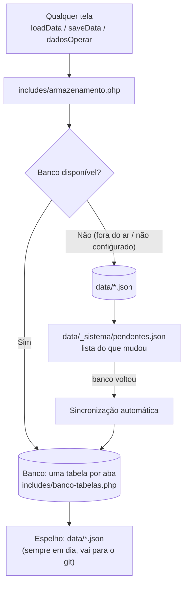

# Banco de dados da Central de Estágios

> Versão 13 (outubro de 2026). Este documento explica **onde os dados ficam**, **como ligar o banco**, **o que acontece quando o banco cai** e **como os arquivos JSON ficam protegidos**.
> Tela de controle: menu **Banco de dados** (`admin-banco.php`). Terminal: `php ferramentas/migrar-dados.php status`.

---

## 1. Resumo em 30 segundos

- **Todas as abas** da Central já leem e gravam no banco de dados. Nenhuma tela precisou mudar: tudo passa pelo `includes/armazenamento.php`.
- **Cada aba tem a sua tabela.** Os nomes já vêm preenchidos (`central_usuarios`, `central_vagas`...). Para usar outros nomes, troque **num lugar só**: `includes/banco-tabelas.php` ou a variável `DADOS_TABELA_<GRUPO>`.
- **Se o banco não for encontrado ou cair**, a Central continua funcionando com os arquivos JSON e anota o que mudou. **Quando o banco volta**, ela envia essas mudanças sozinha.
- **Na primeira conexão**, tudo o que está em `data/*.json` é copiado para o banco (sem apagar nada do que já estiver lá).
- **Toda gravação no banco também vai para o JSON** (espelho). Assim o JSON está sempre em dia e pode ir para o git.
- **Os JSON não podem mais ser baixados pelo navegador**: o `router.php` bloqueia `data/`, `.env`, `docs/` etc.

---

## 2. Como funciona



### 2.1 Ler
1. Lê do banco.
2. Se aquela chave ainda não está no banco, mas existe o JSON, usa o JSON **e já copia para o banco** (migração automática, aos poucos).
3. Se o banco estiver fora, lê do JSON.

Dentro da mesma página, o que já foi lido fica guardado na memória (o painel de alunos lê centenas de arquivos e não repete consultas).

### 2.2 Gravar
1. Grava no banco.
2. Grava também no JSON (espelho). Desligue com `DADOS_ESPELHO_JSON=0` se não quiser.
3. Se o banco falhar, grava no JSON e anota a chave em `data/_sistema/pendentes.json`.

As gravações que precisam de trava (mentoria, chat, denúncias, painéis...) usam **transação** no banco (`SELECT ... FOR UPDATE`, ou `UPDLOCK` no SQL Server) e **trava de arquivo** no JSON. Duas pessoas ao mesmo tempo não se sobrescrevem.

### 2.3 Banco fora do ar
- Cada tentativa de conexão espera no máximo `DADOS_DB_TIMEOUT` segundos (padrão **3**).
- Depois de uma falha, a Central só tenta de novo depois de `DADOS_DB_TENTAR_DE_NOVO` segundos (padrão **30**). Assim as páginas não ficam lentas enquanto o banco está fora.
- A tela **Banco de dados** mostra "Banco fora do ar: usando JSON" e o erro.

### 2.4 Banco voltou (sincronização)
Na primeira página que conseguir conectar, as chaves pendentes são enviadas para o banco:

| Situação | O que acontece |
| --- | --- |
| Ninguém mexeu naquela chave no banco depois | O JSON vai para o banco |
| Alguém mexeu no banco **depois** da gravação no JSON (ex.: duas instâncias) | **O banco vence.** A versão do JSON é guardada em `data/_sistema/conflitos/` (nada se perde) |

O resumo da última sincronização aparece na tela **Banco de dados** e em `data/_sistema/sincronizacao.json`.

### 2.5 Primeira conexão (migração inicial)
Na primeira vez que a Central conecta num banco novo, ela copia **todo** o `data/*.json` que ainda não está no banco. Nada que já esteja no banco é sobrescrito. Fica marcado no banco (`_sistema/migracao_inicial`, na tabela `central_dados`) para não repetir.
Desligue com `DADOS_MIGRAR_AUTO=0` se preferir migrar à mão (tela ou terminal).

---

## 3. Tabela de cada aba

Todas as tabelas têm **o mesmo formato**:

| Coluna | Tipo | O que guarda |
| --- | --- | --- |
| `chave` | `VARCHAR(255)`, chave primária | O nome do dado, ex.: `usuarios`, `users/12/userCurriculum`, `bi/paineis` |
| `conteudo` | `LONGTEXT` (MySQL) / `TEXT` (PostgreSQL, SQLite) / `NVARCHAR(MAX)` (SQL Server) | O dado em JSON |
| `atualizado_em` | `VARCHAR(19)` | `AAAA-MM-DD HH:MM:SS` da última gravação |

| Grupo | Aba / uso | Dados (chaves) | Tabela padrão | Variável para trocar |
| --- | --- | --- | --- | --- |
| `usuarios` | Login, Perfil, Gestão de Alunos, Gestão de Egressos, Cadastro de Alunos (TOTVS) | `usuarios`, `usuarios_backup_totvs` | `central_usuarios` | `DADOS_TABELA_USUARIOS` |
| `perfis` | Perfil do aluno e do egresso (foto, dados extras) | `users/*/userProfile` | `central_perfis` | `DADOS_TABELA_PERFIS` |
| `curriculos` | Currículo | `users/*/userCurriculum` | `central_curriculos` | `DADOS_TABELA_CURRICULOS` |
| `certificados` | Documentos (certificados, arquivados e lixeira) | `users/*/userCertificates`, `users/*/userCertificatesArchive`, `users/*/userCertificatesTrash` | `central_certificados` | `DADOS_TABELA_CERTIFICADOS` |
| `perfil_competencias` | Perfil por Competências (resultado do app de IA) | `users/*/perfilResultado` | `central_perfil_competencias` | `DADOS_TABELA_PERFIL_COMPETENCIAS` |
| `dicas` | Dicas de Carreira (trilhas concluídas) | `users/*/dicasProgresso` | `central_dicas_progresso` | `DADOS_TABELA_DICAS` |
| `vagas` | Vagas, Admin Vagas (vagas da FSA e externas aprovadas) | `platform_jobs` | `central_vagas` | `DADOS_TABELA_VAGAS` |
| `vagas_sugeridas` | Vagas Sugeridas (externas: Gupy / Adzuna) | `vagas_sugeridas` | `central_vagas_sugeridas` | `DADOS_TABELA_VAGAS_SUGERIDAS` |
| `solicitacoes_vaga` | Solicitar Vaga (aluno) e aprovação em Admin Vagas | `job_requests` | `central_solicitacoes_vaga` | `DADOS_TABELA_SOLICITACOES_VAGA` |
| `vagas_egressos` | Divulgar Vaga (egresso) e Gestão de Egressos > Vagas | `egresso_jobs` | `central_vagas_egressos` | `DADOS_TABELA_VAGAS_EGRESSOS` |
| `candidaturas` | Minhas Vagas > Candidaturas, Funil | `users/*/userCandidaturas` | `central_candidaturas` | `DADOS_TABELA_CANDIDATURAS` |
| `favoritos` | Minhas Vagas > Salvas | `users/*/userFavoritos` | `central_favoritos` | `DADOS_TABELA_FAVORITOS` |
| `posts` | Mural / Admin Posts | `platform_posts` | `central_posts` | `DADOS_TABELA_POSTS` |
| `assinaturas` | Assinaturas (aluno) e Admin Assinaturas | `assinaturas` | `central_assinaturas` | `DADOS_TABELA_ASSINATURAS` |
| `mentoria` | Mentoria: pedidos e chat | `mentoria_pedidos` | `central_mentoria` | `DADOS_TABELA_MENTORIA` |
| `denuncias` | Mentoria > Denúncias | `mentoria_denuncias` | `central_mentoria_denuncias` | `DADOS_TABELA_DENUNCIAS` |
| `empresas` | Empresas parceiras (telas desativadas no menu) | `empresas_parceiras` | `central_empresas` | `DADOS_TABELA_EMPRESAS` |
| `cursos` | Regras de estágio obrigatório e horas por curso | `course` | `central_cursos` | `DADOS_TABELA_CURSOS` |
| `alertas` | Alertas e E-mails (fila e resumo semanal) | `fila_emails`, `alertas_estado` | `central_alertas` | `DADOS_TABELA_ALERTAS` |
| `paineis` | Painéis e Relatórios (pastas, painéis, relatórios, planilhas e consultas) | `bi/*` | `central_paineis` | `DADOS_TABELA_PAINEIS` |
| `log_admin` | Ações dos funcionários (justificativas, downloads de conversas...) | `admin_log` | `central_log_admin` | `DADOS_TABELA_LOG_ADMIN` |
| `log_acessos` | Logins (engajamento) | `acessos_log` | `central_log_acessos` | `DADOS_TABELA_LOG_ACESSOS` |
| `totvs` | Integração TOTVS (última sincronização e arquivo de teste) | `totvs_ultima_sincronizacao`, `totvs_exemplo` | `central_totvs` | `DADOS_TABELA_TOTVS` |
| `geral` | Qualquer dado que não está nos grupos acima (e o controle interno da migração) | (qualquer outro dado) | `central_dados` | `DADOS_TABELA_GERAL` |

O `*` quer dizer "qualquer aluno": `users/*/userCurriculum` são os currículos de todos (`users/12/userCurriculum`, `users/13/userCurriculum`...).

### 3.1 Como colocar as SUAS tabelas
Escolha **um** dos dois jeitos:

**a) No arquivo** `includes/banco-tabelas.php`, troque o `'tabela'` do grupo:
```php
'vagas' => [
    'tabela' => 'fsa_vagas',          // <- o nome da sua tabela
    ...
```

**b) Por variável de ambiente** (no `.env` e no Render > Environment). Tem prioridade sobre o arquivo:
```
DADOS_TABELA_USUARIOS=fsa_central.usuarios
DADOS_TABELA_VAGAS=fsa_central.vagas
```
Nome aceito: letras, números, `_` e um `.` para o schema (`central.vagas`, `dbo.central_vagas`).

**Criar as tabelas:**
- Automático (padrão, `DADOS_CRIAR_TABELAS=1`): a Central cria a tabela que não existir.
- À mão (quando a TI não dá permissão de `CREATE`): rode o script do seu banco em `docs/sql/` e coloque `DADOS_CRIAR_TABELAS=0`.
  - `docs/sql/criar-tabelas-mysql.sql`
  - `docs/sql/criar-tabelas-postgresql.sql` (serve para SQLite)
  - `docs/sql/criar-tabelas-sqlserver.sql`
- Pela tela: **Banco de dados > Criar tabelas que faltam**.

**Juntar grupos numa tabela só:** pode. Dê o mesmo nome a vários grupos (a chave primária é o nome do dado, então não há conflito).

### 3.2 Por que o conteúdo fica em JSON (e não uma coluna por campo)?
Porque assim **todas as telas funcionam no banco sem reescrever nada**, e o formato é igual ao dos arquivos, o que permite o espelho, a reserva e a sincronização. Os dados continuam consultáveis por SQL:

```sql
-- PostgreSQL: quantos usuários existem
SELECT json_array_length(conteudo::json) FROM central_usuarios WHERE chave = 'usuarios';
-- MySQL: todos os currículos
SELECT chave, JSON_EXTRACT(conteudo, '$.resumo') FROM central_curriculos;
```

Se no futuro uma tabela precisar de colunas "de verdade" (por exemplo, para o BI corporativo), dá para trocar só aquele grupo no `armazenamento.php`, sem mexer nas telas.

---

## 4. Integrações

| Integração | Onde se conecta | Variáveis | Tabela / consulta |
| --- | --- | --- | --- |
| **Dados da Central** (todas as abas) | Banco da Central | `DADOS_DB_DSN`, `DADOS_DB_USUARIO`, `DADOS_DB_SENHA` | As da seção 3 |
| **TOTVS** (Cadastro de Alunos, tabela "TOTVS: alunos" nos Painéis, origem de Relatórios) | Banco do TOTVS (só leitura) | `TOTVS_MODO=banco`, `TOTVS_DB_DSN`, `TOTVS_DB_USUARIO`, `TOTVS_DB_SENHA` | **`TOTVS_DB_TABELA`** (tabela ou view de alunos) **ou** `TOTVS_DB_CONSULTA` (um SELECT pronto, tem prioridade) |
| **Banco / data lake** (consultas SQL nos Painéis, origem "Banco" dos Relatórios) | Qualquer banco SQL ou data lake com endpoint SQL | `BI_SQL_DSN`, `BI_SQL_USUARIO`, `BI_SQL_SENHA` | A consulta é escrita na própria tela |
| **Vagas externas** (Gupy / Adzuna) | API, sem banco | `VAGAS_FONTE` | O resultado fica em `central_vagas_sugeridas` |
| **E-mails** (Gmail) | API, sem banco | `GMAIL_*` | A fila fica em `central_alertas` |
| **Perfil por Competências** | App Flask (API) | no `includes/perfil_api.php` | O resultado fica em `central_perfil_competencias` |

### 4.1 TOTVS por tabela
Com `TOTVS_DB_TABELA=dbo.VW_CENTRAL_ALUNOS`, a Central faz `SELECT * FROM dbo.VW_CENTRAL_ALUNOS`. A view precisa ter as colunas que o `includes/integracoes/totvs-mapeamento.php` espera (os nomes podem ser trocados lá):

| Coluna | Exemplo |
| --- | --- |
| `RA` | 760876 |
| `NOME` | Lavinia |
| `CPF` | 00000000001 |
| `EMAIL` | lavinia@graduacao.fsa.br |
| `CURSO` | CIENCIA DE DADOS E INTELIGENCIA ARTIFICIAL |
| `PERIODO` | 5 |
| `TURNO` | N |
| `SITUACAO` | ATIVO |

O jeito mais simples de pedir para a TI: **"uma view com essas 8 colunas e um usuário só de leitura nela"**.

### 4.2 Drivers
O `Dockerfile` já instala **MySQL, PostgreSQL e SQLite**. O TOTVS RM costuma usar **SQL Server**, que precisa do driver da Microsoft (`msodbcsql18` e `pdo_sqlsrv`): os passos estão comentados no `Dockerfile`. Faça isso só quando a TI liberar o acesso.

Exemplos de DSN:
```
mysql:host=10.0.0.5;dbname=central;charset=utf8mb4
pgsql:host=meu-banco.render.com;port=5432;dbname=central
sqlite:/var/data/central.db
sqlsrv:Server=10.0.0.9;Database=CorporeRM
```

---

## 5. Passo a passo para ligar o banco

1. **Crie o banco** (por exemplo, PostgreSQL no Render: *New > PostgreSQL*; copie o "External Database URL" e monte o DSN).
2. **Preencha no `.env`** (no seu computador) e em **Render > Environment**:
   ```
   DADOS_DRIVER=auto
   DADOS_DB_DSN=pgsql:host=SEU_HOST;port=5432;dbname=central
   DADOS_DB_USUARIO=central
   DADOS_DB_SENHA=********
   ```
3. **(Opcional) Troque os nomes das tabelas** (seção 3.1).
4. **Rode no computador** `php -S localhost:8000 router.php` e abra qualquer página. Na primeira conexão, as tabelas são criadas e o `data/` é copiado para o banco.
5. **Confira** no menu **Banco de dados**: "Banco de dados" em verde, as linhas de cada tabela e "Conferir banco x JSON" sem diferenças.
6. **Proteja as senhas**: botão **Proteger senhas (hash)** (ou `php ferramentas/proteger-senhas.php`).
7. **Publique**: `git add .`, `git commit`, `git push`.

Pelo terminal, os mesmos passos:
```bash
php ferramentas/migrar-dados.php status
php ferramentas/migrar-dados.php criar-tabelas
php ferramentas/migrar-dados.php para-banco
php ferramentas/migrar-dados.php conferir
```

**Voltar para só JSON:** `php ferramentas/migrar-dados.php para-json` e `DADOS_DRIVER=json`.

---

## 6. Os JSON no git

O `.gitignore` agora **leva todos os JSON de `data/`** para o git (inclusive `acessos_log`, `bi/`, `mentoria_denuncias`, `relatorios`...). Assim o Render sobe com os mesmos dados do seu computador, e o git vira mais uma cópia de segurança.

**Fica de fora só `data/_sistema/`** (controle interno: pendentes, conflitos, trava da sincronização). Isso é de propósito: se o `pendentes.json` do seu computador fosse para o Render, o servidor acharia que tem gravações "pendentes" e mandaria dados velhos para o banco.

Fluxo recomendado com o banco ligado:
1. No computador, com o banco ligado, o espelho mantém `data/*.json` em dia.
2. Para trazer o que foi feito no site publicado: **Banco de dados > Exportar banco → JSON** (no computador) ou `php ferramentas/migrar-dados.php para-json`.
3. `git push`.

Com o banco ligado, o Render lê do banco, então os JSON velhos do deploy **não** sobrescrevem nada (a migração só copia o que falta).

---

## 7. Segurança dos JSON

| Proteção | Como |
| --- | --- |
| Ninguém baixa os dados pelo navegador | `router.php` (Render e `php -S`) e `.htaccess` (Apache) bloqueiam `data/`, `includes/`, `docs/`, `ferramentas/`, `vendor/`, arquivos com ponto (`.env`, `.git`), extensões `.json .md .sql .lock .yml...` e os arquivos de teste. As fotos do currículo em `data/users/<id>/` continuam aparecendo |
| O JSON nunca fica pela metade | Gravação atômica (arquivo temporário + troca) |
| Senhas | Botão **Proteger senhas (hash)** / `ferramentas/proteger-senhas.php`. Ninguém perde o acesso |
| Repositório | Mantenha o repositório do GitHub **privado** (os JSON têm CPF, e-mail e conversas) |
| Downloads | "Baixar cópia (zip)" e "Exportar" ficam no log de ações dos funcionários |

**Teste depois do deploy:** abra `https://SEU-SITE/data/usuarios.json`. Tem que aparecer **"Acesso negado."**

> As senhas protegidas com hash continuam sendo a senha padrão para quem nunca trocou. O próximo passo recomendado é obrigar a troca de senha no primeiro acesso.

---

## 8. Variáveis de ambiente

| Variável | Padrão | Para que serve |
| --- | --- | --- |
| `DADOS_DRIVER` | `auto` se houver DSN, senão `json` | `json` = só arquivos; `banco` ou `auto` = banco com reserva nos JSON |
| `DADOS_DB_DSN` | — | Endereço do banco da Central |
| `DADOS_DB_USUARIO`, `DADOS_DB_SENHA` | — | Acesso ao banco (precisa ler e gravar) |
| `DADOS_DB_TIMEOUT` | `3` | Segundos de espera ao conectar |
| `DADOS_DB_TENTAR_DE_NOVO` | `30` | Segundos sem tentar depois de uma falha |
| `DADOS_TABELA_<GRUPO>` | ver seção 3 | Nome da tabela de cada grupo |
| `DADOS_CRIAR_TABELAS` | `1` | Cria as tabelas que faltam (`0` = só usa as existentes) |
| `DADOS_ESPELHO_JSON` | `1` | Grava também nos JSON |
| `DADOS_MIGRAR_AUTO` | `1` | Migração inicial automática |
| `TOTVS_DB_DSN`, `TOTVS_DB_USUARIO`, `TOTVS_DB_SENHA` | — | Banco do TOTVS (`TOTVS_MODO=banco`) |
| `TOTVS_DB_TABELA` | — | Tabela ou view de alunos do TOTVS |
| `TOTVS_DB_CONSULTA` | — | SELECT pronto (tem prioridade sobre a tabela) |
| `TOTVS_DB_TIMEOUT`, `BI_SQL_TIMEOUT` | `10` | Segundos de espera ao conectar |
| `BI_SQL_DSN`, `BI_SQL_USUARIO`, `BI_SQL_SENHA` | — | Banco / data lake dos Painéis e Relatórios |

---

## 9. Arquivos

| Arquivo | Papel |
| --- | --- |
| `includes/armazenamento.php` | O motor: banco, reserva nos JSON, espelho, pendentes, sincronização, migração |
| `includes/banco-tabelas.php` | **Onde você escolhe as tabelas** |
| `includes/integracoes/banco-conexao.php` | Abre conexões (`DADOS_DB`, `TOTVS_DB`, `BI_SQL`) com tempo limite |
| `admin-banco.php` | Tela **Banco de dados** |
| `ferramentas/migrar-dados.php` | As mesmas ações pelo terminal |
| `ferramentas/proteger-senhas.php` | Senhas em texto puro → hash |
| `router.php`, `.htaccess`, `data/.htaccess` | Bloqueiam o download dos dados |
| `docs/sql/*.sql` | Scripts para criar as tabelas à mão |
| `data/_sistema/` | Controle interno (fora do git) |

---

## 10. Problemas comuns

| Sintoma | Causa | Solução |
| --- | --- | --- |
| Tela mostra "Banco fora do ar: usando JSON" | DSN, usuário ou senha errados, firewall, banco desligado | Veja o erro na tela; teste com **Testar conexão** |
| `could not find driver` | O PHP não tem o driver | Confira o `Dockerfile`; no Windows, ative `extension=pdo_pgsql` (ou `pdo_mysql`) no `php.ini` |
| "A tabela X não existe" | `DADOS_CRIAR_TABELAS=0` e a tabela não foi criada | Rode o script de `docs/sql/` |
| Pendentes não somem | O banco ainda falha ao gravar | **Sincronizar pendentes** e veja o erro no log do servidor |
| Arquivos em `data/_sistema/conflitos/` | Mesma chave mudou nos dois lados | Abra o arquivo, compare com o que está no banco e, se precisar, corrija pela tela da aba |
| `data/usuarios.json` abre no navegador | O servidor não está usando o `router.php` | No Render, confira o `CMD` do `Dockerfile`; no computador, rode `php -S localhost:8000 router.php` |
