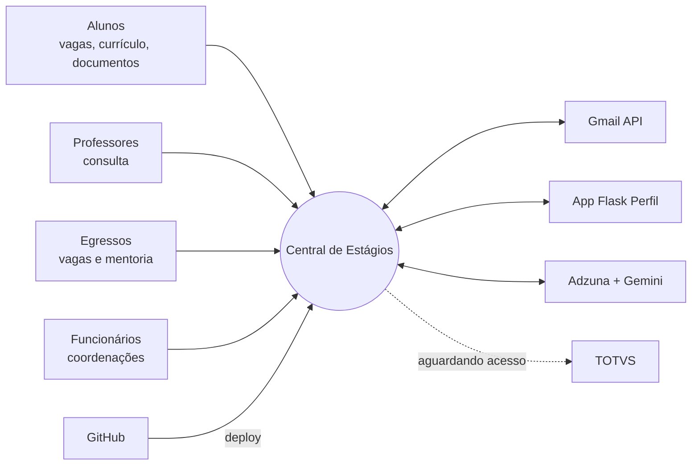
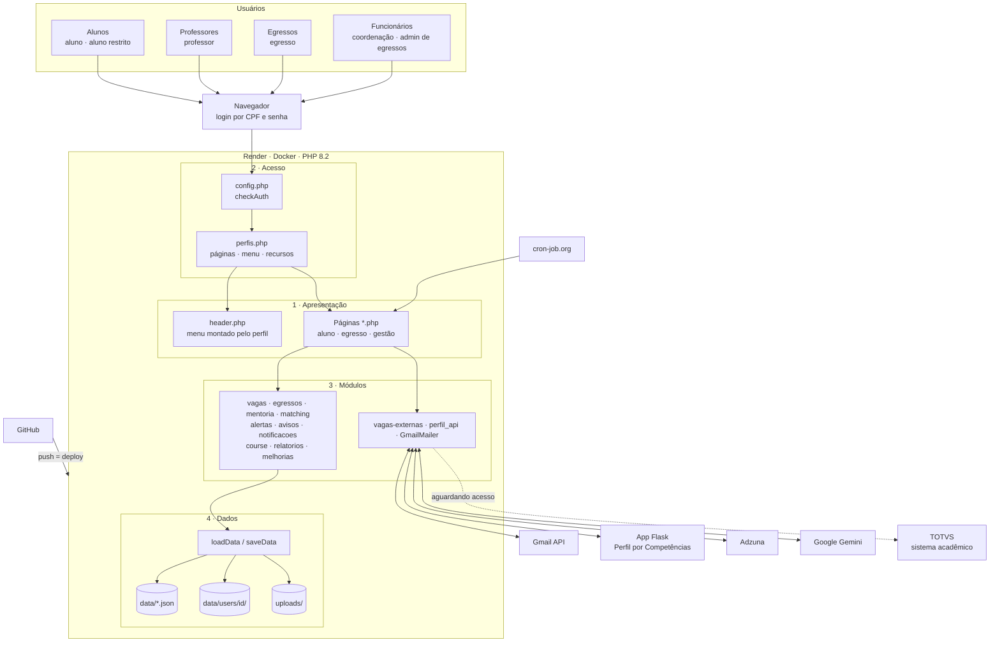
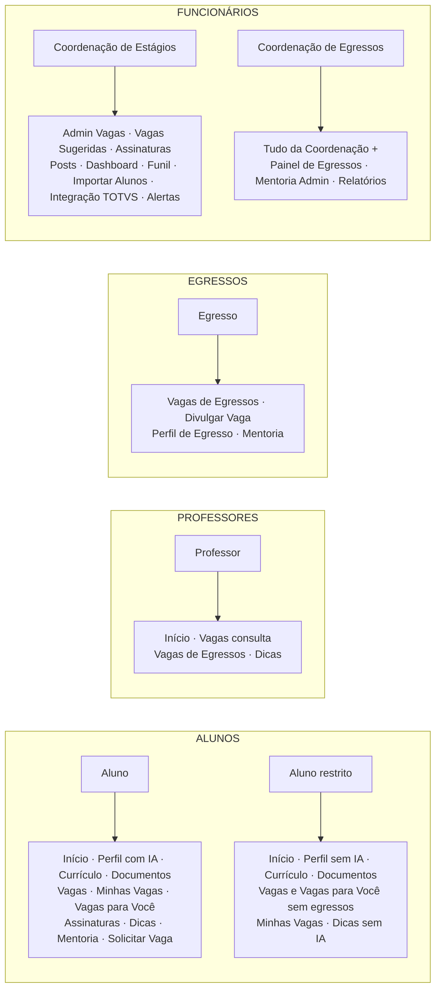
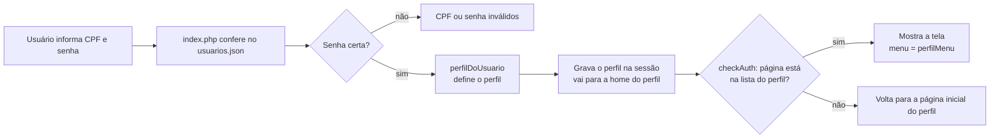
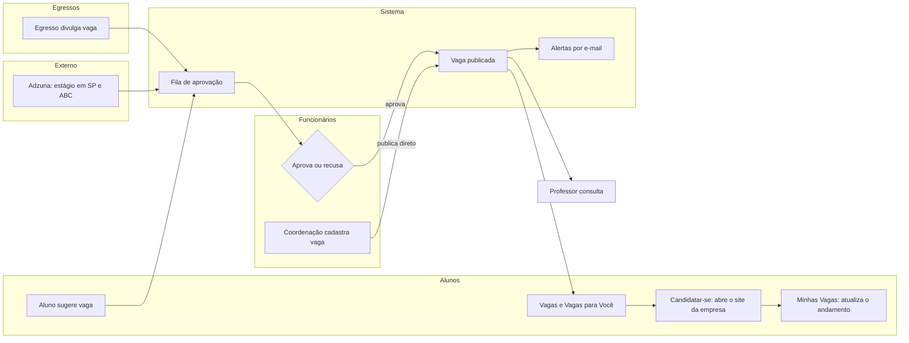
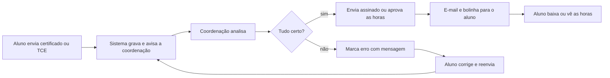
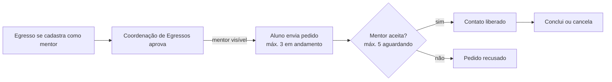
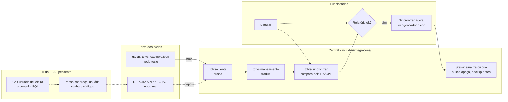

# Diagramas da Central de Estágios em Mermaid

Use este arquivo se o seu Miro tiver a opção de criar diagrama a partir de código Mermaid: copie só o bloco de código de cada diagrama. Se não tiver, use as imagens PNG.

## 0. Visão geral

## 1. Arquitetura em camadas

## 2. Divisão por perfis

## 3. Login e permissão

## 4. Fluxo de vagas

## 5. Documentos e assinaturas

## 6. Mentoria

## 7. Integração TOTVS

